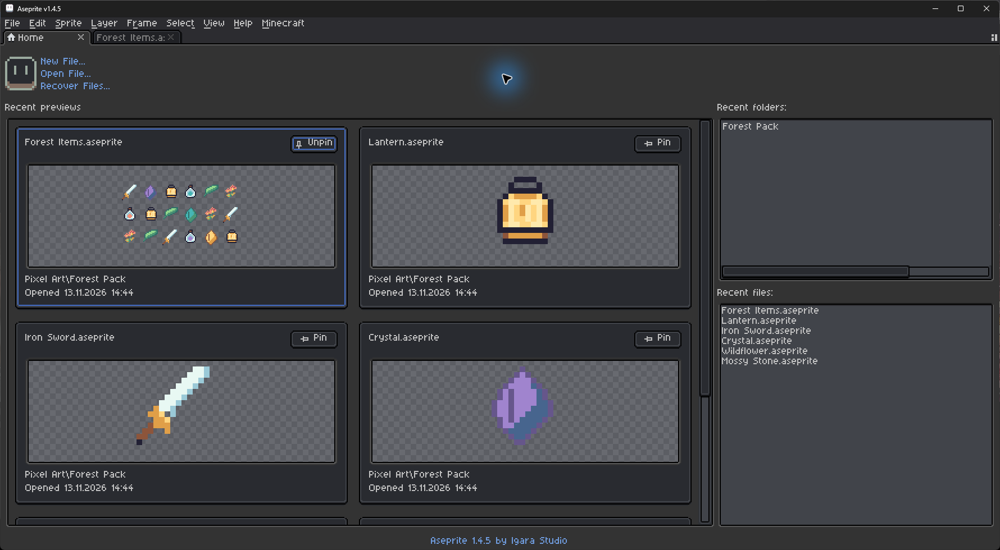
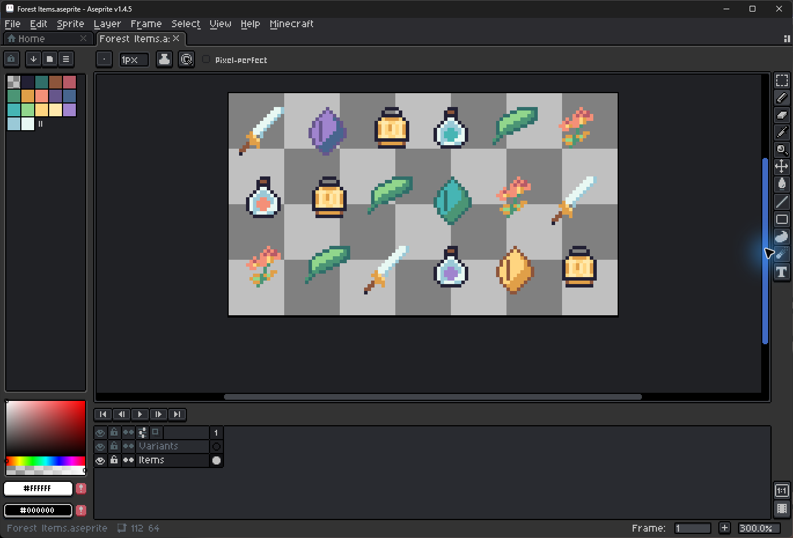
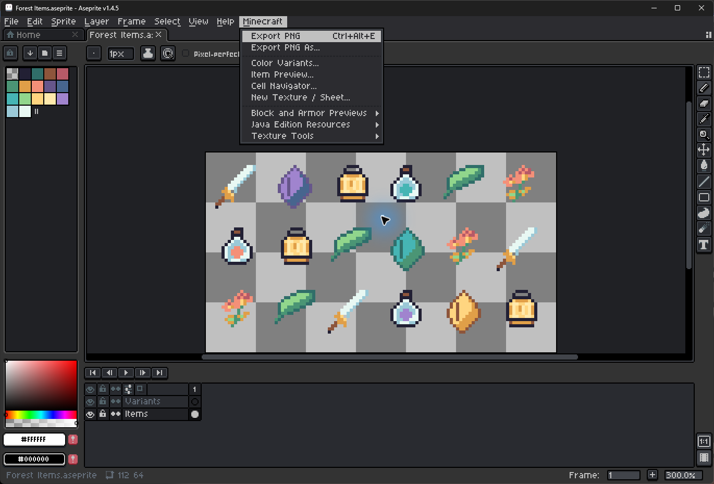

<p align="left"></p>

# Aseprite Java Edition

Форк Aseprite для Windows с инструментами для текстур Minecraft Java Edition. На главной — миниатюры недавних файлов с закреплением и масштабированием. В редакторе — тёмная тема и встроенный русский интерфейс.


[Скачать для Windows](https://github.com/fresh-milkshake/aseprite/releases/latest)



| Sprite Editor | Minecraft Menu |
|:---:|:---:|
|  |  |

## Запуск

Распакуйте ZIP и запустите `aseprite.exe` из распакованной папки. Русский язык включается в **Edit → Preferences → General → Language**. В меню **Minecraft** доступны быстрый экспорт PNG, работа с листами и предпросмотр текстур.

## Сборка

Нужны Visual Studio 2022 с инструментами C++, Git for Windows, CMake и Ninja.

```cmd
git clone --recursive https://github.com/fresh-milkshake/aseprite.git
cd aseprite
build.cmd --auto --norun
```

[Конфигурация сборки и проверок](.github/workflows/windows-release.yml)

## Автор и лицензия

Форк поддерживает [fresh-milkshake](https://github.com/fresh-milkshake). Aseprite создал David Capello, редактор поддерживают Igara Studio и контрибьюторы.

[EULA](EULA.txt) · [Лицензии компонентов и авторы перевода](docs/LICENSES.md)
